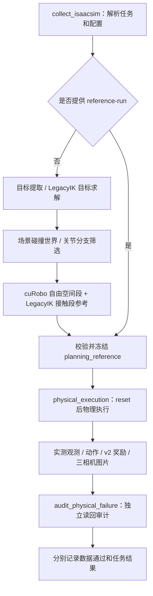

# 主链路与实验链路

整理日期：2026-10-15。所有相对路径和命令均以 `DataPipe/` 项目根目录为基准。

## 1. 主链路的边界

主入口为 `scripts/collect_isaacsim.py`，默认 `execution-mode=physical`、`backend=isaacsim`。
当前实现是 **cuRobo 自由空间规划 + LegacyIK 接触段参考 + 独立物理采集 + 独立审计**。
本次将当前实现作为维护基线，没有改动 IK、任务坐标、碰撞策略、奖励、物理参数或默认执行逻辑。

首先需要理解：**参考生成与最终采集分两次执行；cuRobo 尚未替代接触段 LegacyIK**。
参考生成过程允许部分状态写入和逻辑携物。最终 physical 采集重新 reset，
初始化之后通过实际驱动命令和物理步执行，读取实测状态，不用参考阶段的逻辑携物作为物理抓持证据。

## 2. 主要脚本，按调用顺序阅读

下表文件均相对 `scripts/`。名称中的 `dry_run`、`probe`、`audit` 是历史命名；
这些脚本被主入口实际调用，是生产依赖。

| 顺序 | 文件 / 函数 | 负责的逻辑与交接内容 |
| --- | --- | --- |
| 1 | `collect_isaacsim.py::main` | 解析路线、配置和模式；维护阶段日志、候选重试、任务与世界身份校验，选择生成或复用参考。 |
| 2 | `dry_run_curobo_pick_place_v2_targets_isaac.py` | 提取任务快照、TCP 目标和 LegacyIK 关节目标，写 `targets.json`。 |
| 3 | `audit_curobo_v2_production_world_isaac.py` | 提取实际碰撞几何，构建 cuRobo 世界，写世界报告与 `world_hash`。 |
| 4 | `audit_curobo_v2_pre_pick_branches.py` | 分别筛选 `pre_pick` 和抓后 `place_high` 的可行关节分支。 |
| 5 | `probe_curobo_v2_noncontact.py` | 用 cuRobo 规划到预抓取位和高位转运的自由空间段；转运起点来自接触阶段的实测抬升状态。 |
| 6 | `probe_curobo_v2_legacy_contact_isaac.py` | 用 LegacyIK 生成和执行接近、闭爪、抬升、放置、松爪等参考阶段；先检查抓取抬升，再检查完整拼接候选。 |
| 7 | `build_curobo_pick_place_v2_artifact.py` | 拼接与校验参考轨迹，输出 `trajectory.npz`、`scene_snapshot.json`、`plan_report.json`。 |
| 8 | `collect_isaacsim.py::_finish_physical_collection` | 转入最终物理采集，转发物理参数、检查任务身份、汇总结果并触发审计。 |
| 9 | `collect_physical_failure_isaacsim.py` | 薄命令行入口，调用共享 `physical_execution`；正常自然采集也经过此处。 |
| 10 | `pipelines/curobo_bootstrap/physical_execution.py::run_physical_collection` | 创建场景、reset、发送关节/夹爪目标、推进物理步、读取观测/相机、计算奖励并保存最终数据。 |
| 11 | `audit_physical_failure.py::audit` | 独立检查状态/动作/奖励时序、图片、任务/源码身份、物理约束与成功证据。失败任务也可以产生合法数据。 |

提供 `--reference-run` 时，校验已有参考后直接进入第 8 步。
新规划中候选失败会继续尝试其他分支；全部候选失败会保存原因并返回失败。

配套回放入口：

| 文件 | 用途 |
| --- | --- |
| `replay_physical_trajectory_isaacsim.py` | 回放最终物理产物；`action` 发送保存的实际命令，`state` 用于状态可视化。 |
| `replay_isaacsim.py` | 回放规划参考 / 历史 hybrid 轨迹；主入口的显式 hybrid 分支仍调用它。 |

`--execution-mode hybrid` 是保留的兼容分支，直接交付参考产物，不据此认定物理抓持成功。
本轮没有拆分该分支，以保持现有调用行为。日常采集使用默认 `physical`。

## 3. 控制权分工与共享模块

参考轨迹的主要阶段如下：

| 阶段 | 参考目标来源 |
| --- | --- |
| `free_space_to_pre_pick` | cuRobo |
| `legacy_approach_pick` | LegacyIK |
| `close_gripper` | 夹爪事件 |
| `legacy_lift` | LegacyIK |
| `free_space_transfer` | cuRobo |
| `legacy_place_approach` | LegacyIK |
| `open_gripper` | 夹爪事件 |

最终 physical 阶段由统一执行器消费参考。主入口默认启用 `stable_placement`，
这一分支会通过 `stable_placement_execution.py` 的当前配置执行抓取/放置接近与释放。
理解当前接触控制时，需要同时读参考执行脚本和该模块。

| 模块（相对 `scripts/`） | 阅读重点 |
| --- | --- |
| `pipelines/curobo_bootstrap/task_targets.py` | `PickPlaceV2Config`、`task_snapshot`、坐标转换与 LegacyIK 目标求解。 |
| `native/aubo_ik.py`、`tcp_kinematics.py`、`differential_ik.py`、`ik_controller.py` | IK 数学核心、TCP/法兰关系、增量控制、动作应用；来源见 `native/control_provenance.json`。 |
| `native/scene.py`、`sim_backend.py` | 原生 Isaac Sim 场景、驱动、相机适配与后端选择。 |
| `pipelines/curobo_bootstrap/planner.py`、`curobo_collision.py`、`collision_model.py` | cuRobo 调用、碰撞约束、限位与轨迹接受条件。 |
| `pipelines/curobo_bootstrap/stable_placement_execution.py` | 当前五状态抓放配置、接触段推进、松爪与稳定判据。 |
| `pipelines/curobo_bootstrap/physical_failure.py` | 抓持证据、奖励观测及最终 NPZ/JSON 写出。 |
| `pick_place_reward_candidate.py`、`pick_place_reward_candidate_v2.py` | v1 基础类型与 v2 评分实现；虽名为 candidate，已是主链路依赖。 |
| `pipelines/curobo_bootstrap/physical_reward_validity.py` | 奖励有效性门禁；任务成功不自动使完整训练奖励有效。 |
| `pipelines/curobo_bootstrap/pick_place_artifact.py`、`route_identity.py`、`contracts.py` | 参考数据字段、读写校验、任务身份与哈希契约。 |
| `sequence.py`、`source2_routing.py`、`state4_routing.py` | 阶段推进和特殊路线定义，也是当前目标/参考链路的共享依赖。 |
| `records.py`、`hdf5_*`、`aligned_schema.py`、`r2dreamer.py` 等 | 包公共接口与共享数据契约；数据集配置来自 `configs/dataset.py`，不表示主入口在写 HDF5。 |

当前 `scripts` 的 69 个文件和 `configs` 的 25 个文件依赖关系见 [清单](pipeline_layout_20261015.json) 的 `retained[].dependencies`、`configuration[].dependencies`。
推荐先读编排入口与控制权分工，再按执行器 → 目标/配置 → IK → 数据写出的顺序深入。

## 4. 配置与数据流

| 配置 | 所有权 |
| --- | --- |
| `configs/dataset.py` | 数据集 schema、动作/单位约定、`DatasetConfig`、`CameraSensorSpec` 与字段定义。 |
| `configs/baseline.py` | `SceneBaseline` 与静态 IK 场景基线描述。 |
| `configs/camera.py` | 从视觉诊断配置生成三路相机契约和带相机的 `DatasetConfig`。 |
| `configs/task.py::TARGET_STATES` | 五个任务状态及当前抓取/放置 TCP 等目标，索引 `0..4`。 |
| `configs/coordinate_frames.py` | 机器人、场景与 TCP 坐标关系。 |
| `configs/aubo_ik_control.py` | IK 与机械臂控制参数。 |
| `configs/assets.py`、`configs/scene.py` | 资产与场景定义。 |
| `configs/vision_diagnostics.py`、`configs/render.py` | 观测相机与视口配置。 |
| `configs/curobo/robot.py`、`planner.py`、`world.py` | cuRobo 机器人、规划和世界配置。 |
| `configs/curobo/route_presets.py` / `.json` | 已登记路线的参数组合；旧成功预设不等于当前配置已通过。 |

默认 `<output>_evidence/` 保存阶段日志、目标/世界/候选报告和 `run_report.json`；
新规划参考位于其 `planning_reference/`。也可指定 `--evidence-output`。
最终 `<output>/` 保存实测 `trajectory.npz`、`observations.npz`、`trace.json`、
`rewards.json` / `rewards.npz`、`scene_snapshot.json`、`report.json` 和相机图像索引。
图像默认在 `execution_visualization/`；显式证据/图像目录参数可能改变位置，应按报告引用读取。

观测/状态长度为 `T+1`，奖励和实际动作长度为 `T`。
`run_report.json::passed` 表示采集/数据审计通过；任务成功读取 `task_succeeded/outcome`；
完整训练奖励是否可用读取 `reward_valid`。当前完整碰撞证据仍不齐全，完整训练奖励继续由现有门禁控制。

## 5. 实验链路与目录迁移

本轮将主入口及回放依赖闭包之外的 **106 个 Python 文件**移入 `testscripts/`，
保持原相对层级，训练任务的 18 个 YAML 资源随目录移动。原有 26 个回归测试仍在 `testscripts/`。
已有数据、历史证据及其源码快照保持原位置。

| 用途 | `testscripts/` 中的代表入口 |
| --- | --- |
| 旧 HDF5 采集/验证/回放 | `collect_aubo_ik_dataset_isaac.py`、`validate_aubo_ik_dataset.py`、`audit_alignment_dataset.py`、`replay_aubo_ik_trajectory.py` 及专用辅助模块。 |
| 历史整图与批量路线 | `collect_curobo_pick_place_v2_graph.py`、`collect_run003_isaacsim.py`、`collect_five_state_gui_test.py`、`collect_state4_*` 与相应 audit/finish/recover 脚本。 |
| 状态搜索、对比和诊断 | `search_state2_pre_pick.py`、`search_stable_placement_isaacsim.py`、`diagnose_*`、`compare_*`、`experimental_state2_visual.py`。 |
| 奖励离线评审 | `evaluate_*rewards*.py`、`finalize_physical_reward_evidence.py`；实际采集依赖的奖励实现仍在 `scripts/`。 |
| 资产推导与几何检查 | `derive_curobo_*`、`export_*`、`inspect_*`、`native/gripper_geometry.py`。 |
| 旧 cuRobo MVP | `plan_curobo_mvp.py`、`replay_curobo_trajectory*_isaac.py` 和专用 `pipelines/curobo_bootstrap/` 模块。 |
| 训练模板及 UI 示例 | `rl_games/`、`rsl_rl/`、`sb3/`、`skrl/`、`tasks/`、`ui_extension_example.py`、`list_envs.py`。UI 示例不再自动注册到采集扩展。 |
| 离线回归和目录边界检查 | `test_*.py`、`curobo_bootstrap/test_*.py`、`check_pipeline_layout.py`。 |

迁移后的导入名为 `testscripts.<模块>`，共享依赖仍使用 `scripts.<模块>`。
实验中混用主链路和实验阶段的子进程路径由 `testscripts/script_paths.py` 定位，
文件不存在或两边重名时直接报错。同步修改了 pytest 默认目录、安装包发现和 VS Code 训练启动模板。

## 6. 后续用 cuRobo 替换 LegacyIK 的工作方式

允许的依赖方向是 `testscripts -> scripts/configs`。主链路不得导入或启动 `testscripts`。
后续可建 `testscripts/curobo_contact_execution/`，放独立入口、执行器和实验配置；
复用主链路场景、数据契约与审计，不修改主配置默认值来切换实验。
这是扩展建议，本轮没有实现新的 cuRobo 接触执行器，也没有增加后端开关。

一次实验先替换一个明确阶段，例如 `legacy_lift`，记录输入状态、输出命令和结束条件。
实验使用独立新输出目录并记录源码/配置版本，保持任务身份、TCP 坐标、时序、实测物理和相机证据契约。

合入主链路前的验收标准：

1. 明确替换的模块/阶段、行为差异和数据契约变化。
2. 在相同任务、场景和物理参数下对比，分别记录任务成功、数据审计和奖励有效性。
3. 机器人轨迹测试采用非无头 GUI，保存原生相机图片以及可读回的轨迹和报告。
4. 对应离线回归与独立产物审计通过；既有失败单独解释，不放宽门禁来标记成功。
5. 取得证据后再迁入 `scripts`，更新默认入口、依赖清单和本文，明确主链路版本变化。

## 7. 本轮验收记录

| 验收项 | 结果与复现 |
| --- | --- |
| 首次目录清理 | 当时保留的 72 个文件 SHA-256 与清理前相同；随后进行了第 8 节的配置迁移。原始哈希保留在清单中。 |
| 当前源码基线 | `python testscripts/check_pipeline_layout.py --verify-cleanup-hashes` 校验当前记录的源码基线；配置迁移后使用 `sha256_current`。后续有意修改实现时同步更新清单。 |
| 目录及依赖边界 | `python testscripts/check_pipeline_layout.py` 检查清单、迁移目标、Python 语法、本地导入、迁移旧路径、反向实验依赖及主编排子进程文件。 |
| 回归无新增失败 | 整理前后均为 **257 通过 / 11 失败**，失败项相同。`python -m pytest -q -p no:cacheprovider --basetemp outputs/<NEW_TEST_DIR>`。 |
| 验证范围 | 离线结构与回归，没有启动 Isaac Sim，没有生成新轨迹或图片。本次结构验收不等于物理/路线成功验收。 |

整理前已存在的 11 个失败项，本轮没有修改相应控制行为或旧断言：

- `test_route_height.py`：`test_saved_state4_geometry_all_five_targets_solve_at_030[2-4]`，1 项。
- `test_route_presets.py`：4 项 state4 出发与 3 项到 state4 的旧成功几何断言，7 项。
- `test_source2_routing.py`：`test_source2_snapshot_and_sequence_have_same_pre_pick_and_unchanged_grasp`，1 项。
- `test_native_migration.py`：`test_native_render_waits_for_rgb_content_instead_of_opaque_alpha[0/4]`，2 项。

结构报告与回归 XML 保存在 `outputs/pipeline_cleanup_20261015/`。
完整旧 README 保存在 [历史管线说明](历史管线说明_20261015.md)。历史文档中尚保留的旧脚本路径按迁移清单查找，原实验记录未作批量改写。

## 8. 配置模块归位（2026-10-15）

| 原位置 | 当前位置 | 用途 |
| --- | --- | --- |
| `scripts/config.py` | `configs/dataset.py` | 数据集字段、单位、动作维度与配置类型。 |
| `scripts/baseline.py` | `configs/baseline.py` | 静态场景事实与基线。 |
| `scripts/camera_config.py` | `configs/camera.py` | 相机与数据集配置的静态构建。 |

主链路和实验脚本统一使用新导入路径，没有在旧位置保留转发文件。
`from scripts import DatasetConfig` 等既有包级公开导出继续可用。
配置模块不导入 `scripts` 或 `testscripts`；配置值、校验条件及执行语句均未改变。
混有规划/执行行为的模块仍放在 `scripts`，例如 `sequence.py`、`task_targets.py` 和 `contact_timing.py`。

本轮检查结果：配置独立导入、三相机配置校验、主入口及数据验证/奖励评审入口参数检查通过；
离线回归仍为 257 通过、同样的 11 项失败。
通过移除导入节点后的 Python 语法树对比，确认迁移涉及的文件只有导入语句变化。
证据、迁移前源码快照及清单快照保存于 `outputs/config_relocation_20261015/`。
